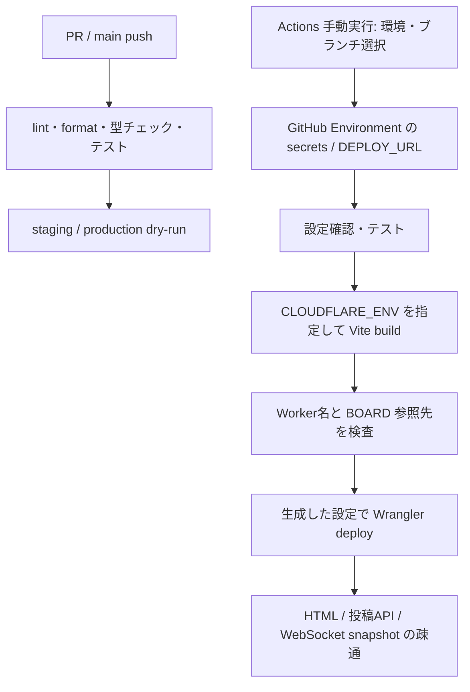
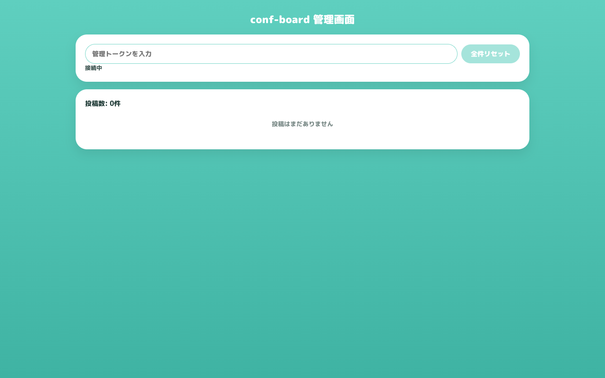

# デプロイ整備の仕組み・検証記録

2026-09-07、macOS上のローカルビルドで確認。ベースは `389f218`。モデル修正とGo/Wasm本体の差分は含みません。下記ログはコマンドの実出力で、checkoutの絶対パスのみ置き換えています。

| 環境       | Worker名           | 投稿データ            |
| ---------- | ------------------ | --------------------- |
| staging    | conf-board-staging | staging自身のBoard    |
| production | conf-board         | production自身のBoard |

`BOARD` は `script_name` を指定せず同じWorker内のクラスを参照します。公開先をビルド時に決定し、生成設定も検査します。管理トークンは一時ファイル（0600）で渡して最後に削除します。CIにデプロイ用secretは不要です。環境ごとのデプロイは直列実行します。

| 検証                                | 結果・証跡                                             |
| ----------------------------------- | ------------------------------------------------------ |
| lint / format / TypeScript / Vitest | [210テスト成功](check.txt)                             |
| staging bundle                      | [dry-run成功](staging-dry-run.txt)                     |
| production bundle                   | [dry-run成功](production-dry-run.txt)                  |
| HTTP / API / WebSocket              | [全5経路成功](smoke.txt)                               |
| Chrome画面確認                      | [3画面成功](browser.txt)、[ブラウザ情報](browser.json) |

再実行: `pnpm check` → `pnpm run deploy staging --dry-run` → `pnpm run deploy production --dry-run`。続けて `pnpm exec vite preview --host 127.0.0.1 --port 4173` を起動し、`pnpm smoke http://127.0.0.1:4173` と `node scripts/check-deploy-browser.cjs` を実行します。ブラウザスクリプトはPlaywrightを利用します。必要なら `PLAYWRIGHT_MODULE` と `CHROME_PATH` を指定してください。

## 独立したサブエージェントによるレビュー

デプロイ担当が環境分離、秘密情報、一時ファイル、CLI引数、公開先検査、CI、復旧手順をread-onlyレビューしました。重大な不具合は見つかりませんでした。

- 指摘: Go/Wasm統合時にGoテストがCIから漏れる → go.modが存在するとGoセットアップと `go test ./...` をCI・Deploy両方で実行するよう対応。
- 指摘: SQLスキーマ移行とWranglerクラス移行の説明が曖昧 → READMEで区別。
- 検証範囲: smokeはJS実行を検証しない → ブラウザ確認を別途実施して証跡を添付。

Cloudflareへの実公開、リモートの環境分離、管理トークンを使った実環境操作は未検証です。初回公開にはGitHub Environmentの3つのsecretとDEPLOY_URL、workflowのmainへの反映が必要です。Go条件分岐のGitHub Actions上での実行はWasm統合後に確認します。
