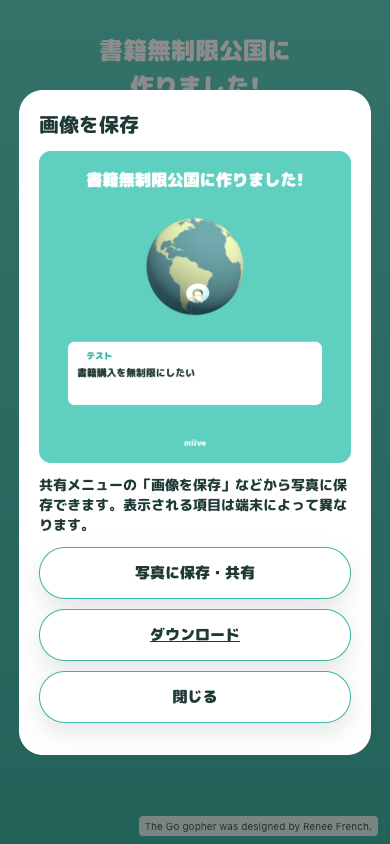

# 投稿後の共有・保存の確認

2026-09-09、ローカル本番ビルドをChromeの390×844表示で確認。

- 不要な再投稿ボタンと送信キャプションがないことを確認。
- Xのintent URLを捕捉し、本文直後の改行と末尾の `@miive_jp` を確認。Xへ実投稿はしていません。
- ネイティブ共有APIをスタブにして、共有時にユーザー操作が有効でPNGファイルが渡ることを確認。
- 共有のキャンセルではエラーなし、共有失敗ではダウンロード案内を表示。
- ファイル共有非対応では共有ボタンを隠し、PNGをダウンロード可能。
- プレビューPNGは1080px、閉じる操作でダイアログが消えることを確認。

`pnpm check` と `pnpm build` は成功。iOS/Android実機のOS共有メニューと写真アプリへの保存は未検証です。「画像を保存」などの共有先はOS・ブラウザが提供するため、必ず表示されるとは限りません。

再実行: ビルド後 `pnpm exec vite preview --host 127.0.0.1 --port 4175` で起動し、`node scripts/check-phone-sharing.cjs`。PlaywrightとChromeの場所は `PLAYWRIGHT_MODULE` / `CHROME_PATH` で指定できます。投稿APIはスタブのため、本番への投稿はしません。
