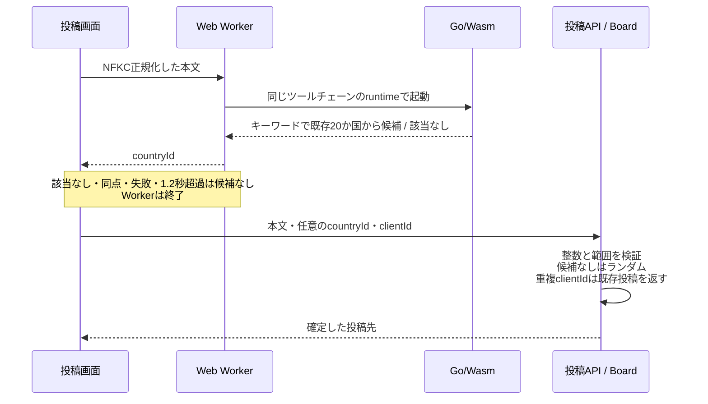
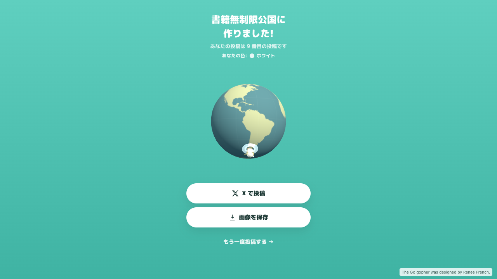

# Go/Wasmの仕組み・検証記録

2026-09-07、実装コミット `01cbf1a` をmacOS / Chromeで再検証しました。ログは実出力で、checkoutの絶対パスのみ置き換えています。

| 検証                        | 結果・証跡                           |
| --------------------------- | ------------------------------------ |
| lint / format / 型 / Vitest | [216テスト成功](check.txt)           |
| Go単体テスト                | [成功](go-test.txt)                  |
| 本番ビルド                  | [成功、Wasmはgzip約597KB](build.txt) |
| Chrome投稿                  | [4ケース成功](browser.txt)           |

Chromeでは書籍の本文→国ID3の保存、キーワードなし、Wasm通信を遮断、Wasm通信を1.8秒遅延の4ケースを確認しました。いずれもAPIは201で到着画面まで進みます。失敗・遅延時は候補を送らず、サーバーが有効な国IDを割り当てます。

再実行: `pnpm check`、`pnpm run test:go`、`pnpm build`。`pnpm exec vite preview --host 127.0.0.1 --port 4174` の起動後に `node scripts/check-country-browser.cjs`。Playwright環境が必要で、`PLAYWRIGHT_MODULE` / `CHROME_PATH` で場所を指定できます。ローカルに4投稿を作成します。

## 独立したサブエージェントによるレビュー

Wasm担当がWorker終了処理、タイムアウト、API範囲検証、投稿の冪等性、GoとTypeScriptの国ID対応をread-onlyレビューしました。修正必須の不具合は見つからず、Goテスト・型チェック・差分チェックもレビュー担当が再実行して成功しました。上記ブラウザ4ケースは主担当による検証です。

残る範囲: Chrome以外、低速実機、Worker生成失敗や不正メッセージ、NFKC正規化そのものの専用自動テスト。分類はキーワード方式で、否定や意味を解釈しません。外部AIへの送信や新しい国名の生成は行いません。GoとTypeScriptの国ID順序は今後の変更時にも同期が必要です。
